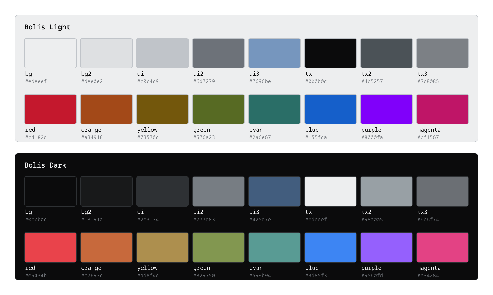

# Bolis

A cool toned gray theme with punchy colors. Themes have currentl been built for
**Neovim**, **Ghostty**, and **Noctalia**, in light and dark variants. 

The [`color-palette.json`](color-palette.json) is the source of truth, and was 
created using my [Paleta Palette Studio](https://github.com/Narwhai/paleta-palette-studio) 
to generate a palette in OKHSL space. The colors are then used to generate the 
Neovim, Ghostty, and Noctalia themes.

Precise colors are subject to change as I use this and apply it to more applications.
I've included a verification script to check that the colors in the various themes 
match the palette to prevent drift if changes are made to the palette.

## Palette



| Role    | Light     | Dark      | Use                                        |
| ------- | --------- | --------- | ------------------------------------------ |
| bg      | `#edeeef` | `#0b0b0c` | main background                            |
| bg2     | `#dee0e2` | `#18191a` | elevated panels, floats, cursor line       |
| ui      | `#c0c4c9` | `#2e3134` | borders, separators, selection background  |
| ui2     | `#6d7279` | `#777d83` | secondary UI foreground, window borders    |
| ui3     | `#7696be` | `#425d7e` | muted blue accent for selected/focused UI  |
| tx      | `#0b0b0c` | `#edeeef` | primary text                               |
| tx2     | `#4b5257` | `#98a0a5` | secondary text (statusline, line numbers)  |
| tx3     | `#7c8085` | `#6b6f74` | tertiary text — comments, dimmed by design |
| red     | `#c4182d` | `#e9434b` | errors and deletions                       |
| orange  | `#a34918` | `#c7693c` | constants, numbers                         |
| yellow  | `#73570c` | `#ad8f4e` | types                                      |
| green   | `#576a23` | `#829750` | strings                                    |
| cyan    | `#2a6e67` | `#599b94` | builtin variables, symbols                 |
| blue    | `#155fca` | `#3d85f3` | functions                                  |
| purple  | `#8000fa` | `#9560fd` | imports, preprocessor                      |
| magenta | `#bf1567` | `#e34284` | keywords                                   |

## Neovim

Requires Neovim ≥ 0.9 and `termguicolors` enabled.

```
:colorscheme bolis         " follows 'background'
:colorscheme bolis-light
:colorscheme bolis-dark
```

Install with [lazy.nvim](https://lazy.folke.io). This repository is a valid
plugin, yes this means unecessary files are cloned, but I don't have a reason to
improve that yet

Add to your `plugins.lua`:

```lua
{
  "Narwhai/bolis-theme",
  lazy = false,
  priority = 1000,
  config = function()
    vim.cmd.colorscheme("bolis")
  end,
},
```

`setup()` only stores options and does not re-apply them, so it must run
before the scheme loads. Put highlight overrides in the same `config`:

```lua
config = function()
  require("bolis").setup({
    overrides = {
      Normal = { bg = "NONE" }, -- transparent background
    },
  })
  vim.cmd.colorscheme("bolis")
end,
```

Covers treesitter (current and legacy capture names), LSP semantic tokens,
diagnostics, diffs, and the following plugins: blink.cmp, nvim-cmp, telescope,
which-key, lazy, mason, nvim-notify, noice, gitsigns, indent-blankline,
neo-tree, nvim-tree, bufferline, trouble, treesitter-context, flash, leap,
dashboard, alpha, nvim-dap + dap-ui, mini.nvim, rainbow-delimiters,
vim-illuminate.

## Ghostty

Copy the theme files into Ghostty's themes directory:

```sh
mkdir -p ~/.config/ghostty/themes
cp ghostty/themes/* ~/.config/ghostty/themes/
```

Then pick one in `~/.config/ghostty/config`:

```
theme = Bolis Dark
# or follow the desktop light/dark preference:
theme = light:Bolis Light,dark:Bolis Dark
```

The ANSI palette 0–15, cursor, and selection colors are identical to the
scheme's terminal colors in Neovim, so `:terminal` inside Neovim matches
Ghostty. ANSI slots 3/11 (yellow) use orange/yellow and 5/13 (magenta) use
purple/magenta so all eight accents fit the 16-color palette.

## Noctalia

Copy or symlink the palette into Noctalia's custom palettes directory:

```sh
mkdir -p ~/.config/noctalia/palettes
ln -sf "$PWD/noctalia/Bolis.json" ~/.config/noctalia/palettes/Bolis.json
```

Then pick **Bolis** under Settings → Colors, or select it from the CLI:

```sh
noctalia msg color-scheme-set custom Bolis
```

The dark and light variants follow Noctalia's theme mode. Its terminal colors
match the Ghostty themes.

## Verify

Checks that `palette.lua`, the Ghostty themes, and the Noctalia palette still
match `color-palette.json`, and smoke-tests loading all variants:

```sh
nvim --headless --clean -l scripts/verify.lua
```

## Regenerate the palette preview

`assets/palette.svg` is generated from `color-palette.json` (8 swatches per row:
base roles, then accents, for each mode). Re-run after editing the palette:

```sh
nvim --headless --clean -l scripts/render-palette.lua
rsvg-convert -z 2 -o assets/palette.png assets/palette.svg
```

## Layout

```
color-palette.json         source of truth (Bolis palette, OKHSL)
colors/bolis*.lua           colorscheme entry points
lua/bolis/                  palette, highlights, loader
ghostty/themes/            Ghostty theme files
noctalia/Bolis.json         Noctalia custom palette
assets/palette.svg          generated palette preview
scripts/render-palette.lua  regenerates the palette preview
scripts/verify.lua          sync + smoke-test verifier
```
